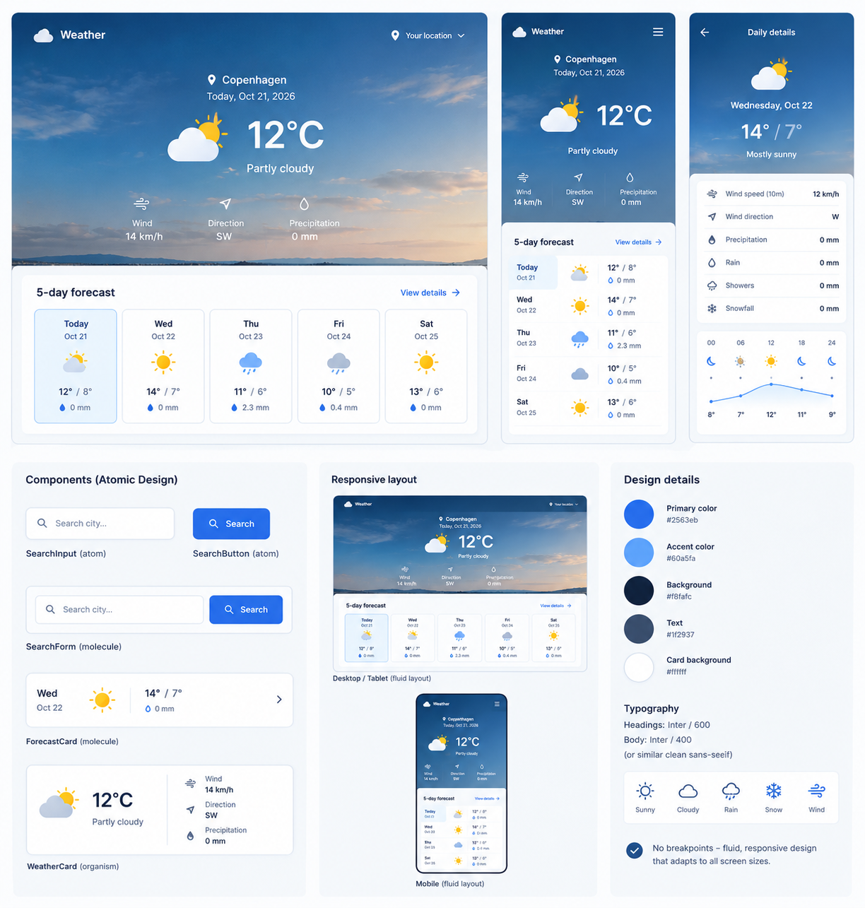

# Weather App

A responsive weather dashboard built with vanilla JavaScript, ES modules, and the MVC architecture. Weather data is provided by the [Open-Meteo API](https://open-meteo.com/).

## Design

The application uses a clean, responsive layout to present current weather conditions and a five-day forecast. Users can search for cities and select individual forecast days to view detailed weather information.

## Features

- Current weather based on the user's location
- Five-day weather forecast with selectable daily details
- Search for weather by city
- Temperature, wind speed, wind direction, and precipitation information
- Weather icons and conditions
- Responsive layout without CSS breakpoints
- Progressive Web App (PWA) with an app icon
- Offline support using service workers and caching

## Technologies

- HTML, CSS, and JavaScript
- ES modules
- Model-View-Controller (MVC) architecture
- Atomic Design component structure
- Open-Meteo API
- Service Workers and Web App Manifest
- GitHub Pages

## Run Locally

Open `index.html` using a local development server, such as the **Live Server** extension in Visual Studio Code.

Location-based weather requires browser permission. Internet access is required for fresh weather data; previously cached data may be available offline.

## Caching Strategies

- **Network First:** Weather API requests attempt to retrieve fresh data from the network, falling back to cached responses when the network is unavailable.
- **Cache First:** Static application assets are loaded from the cache when available, falling back to the network when necessary.

## API

Weather forecasts and city geocoding are provided by the [Open-Meteo API](https://open-meteo.com/).

## Deployment

The application is deployed using GitHub Pages.